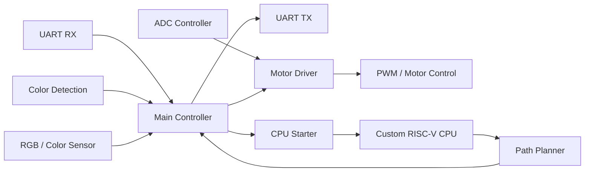

> **Note:** The project design and implementation were carried out by the team. This README is an AI-assisted summary of the project, prepared from the team's project files and manually reviewed. 

# 🌱 EcoMender Bot

**🏆 eYRC 2024–25 · Team 3699 · 4th Place out of 528 teams — EcoMender Bot Theme**

An autonomous line-following FPGA-based robot developed for the **e-Yantra Robotics Competition (eYRC 2024–25)**, organized by **e-Yantra, IIT Bombay**. The team was selected as one of **6 finalists out of 528 teams** in the EcoMender Bot theme and secured **4th position**.

**Team:** Nishanth K S · Adithya S · Kathir B · Harikaran S

---

## Table of Contents

- [Project Overview](#project-overview)
- [Highlights](#project-highlights)
- [Known Limitations](#-known-limitations)
- [Competition Design — Task 6](#competition-design--task-6)
- [System Features](#system-features)
- [System Architecture](#system-architecture)
- [Clock Domains](#clock-domains)
- [Typical System Flow](#typical-system-flow)
- [Repository Structure](#repository-structure)
- [Build and Program](#build-and-program)
- [Simulation](#simulation)
- [Hardware / Software Integration](#hardware--software-integration)
- [Competition Achievement](#competition-achievement)
- [Project Learning Areas](#project-learning-areas)
- [Reference Documents](#reference-documents)
- [Notes for Developers](#notes-for-developers)
- [License](#license)

---

## Project Overview

The system integrates:

- Line sensing and autonomous line following
- Color detection
- UART communication
- A custom 5-stage pipelined RISC-V processor
- Path planning
- Motor and servo control
- FPGA-based hardware/software integration on an **Intel Cyclone IV E `EP4CE22F17C6`**

The design was implemented primarily in **Verilog HDL**.

---

## Project Highlights

- 🧠 Custom **5-stage pipelined RISC-V processor**
- 💻 RTL development using **Verilog HDL**
- 🤖 FPGA-based autonomous robot control
- 🛞 Line following and motor control using PWM
- 📡 UART communication at **115200 baud**
- 🎨 RGB/color detection using a TCS3200-style sensor
- 🧭 Hardware-assisted path planning
- 🔌 ADC-based line sensing
- ⚙️ Servo and event control
- 🔄 Hardware/software integration between the custom CPU and FPGA control logic
- 🎯 Target FPGA: **Intel Cyclone IV E `EP4CE22F17C6`**

---

## ⚠️ Known Limitations

The current `path_planner.v` implementation steps through a **hard-coded `PATH_PLANNED` array**, and the CPU memory-write fill logic is currently commented out.

This portion of the repository should be treated as an **integration/demo implementation** of the path-planning interface rather than a fully parameterized path-planning engine. Anyone extending this project should review the CPU/path-planner interface (`cpu_starter.v` + `path_planner.v`) before generalizing it.

---

## Competition Design — Task 6

The integrated competition design is located at:

```text
task 6/task6/task5a/
```

| Item | Path |
|---|---|
| Main project | `task 6/task6/task5a/LINE_FOLLOWER.qpf` (open with Intel Quartus Prime) |
| Programming file | `task 6/task6/task5a/output_files/LINE_FOLLOWER.sof` |
| Pin assignments | `task 6/task6/task5a/LINE_FOLLOWER.qsf` |
| FPGA pin reference | `fpga_pins.pdf` |

> **Note on `Task 6(semi)/`:** this is an alternate/in-progress snapshot of Task 6 kept for reference. The authoritative build is `task 6/task6/task5a/`.

---

## System Features

### 1. Line Following
📁 `ADC_controller.v`, `motor_driver.v`

Combines ADC-based sensing (via an **ADC128S022**) with PWM motor control. Handles line tracking, node detection/counting, turns, motor direction, and obstacle-related behavior.

### 2. Color Detection and LEDs
📁 `RGB.v`, `t1b_cd_fd.v`

Uses a **TCS3200-style color sensing arrangement** (see `tcs3200-e11.pdf`). Communicates with the main controller to support competition workflow and state transitions.

### 3. UART Communication
📁 `uart_rx.v`, `uart_tx.v`

Used for competition messages and coordination between the external communication interface and the robot control logic. See [UART Configuration](#uart-configuration) for specs. Example competition message data: `task 6/task6_original.json`.

### 4. Custom RISC-V Processor
📁 `cpu_starter.v`, `cpu_codes/`, `path_planner.v`

A custom **5-stage pipelined RISC-V architecture** used for path-planning related computation. The processor can load start and end points and feed the robot's navigation workflow.

### 5. Path Planning
📁 `path_planner.v`, integrated with `cpu_starter.v`

The CPU starter logic interfaces between the main controller and the RISC-V processor. See [Known Limitations](#-known-limitations) above.

### 6. Main Controller
📁 `main_controller.v`

The primary finite-state-machine controller, coordinating UART communication, robot states, path-planning enable, motor/servo actions, color detection workflow, event indicators, and competition state transitions.

---

## System Architecture



---

## Clock Domains

The project uses frequency scaling (`frequency_scaler.v`, `Frequency_Scaling.v`) to derive:

| Frequency | Used for |
|---|---|
| ~3.125 MHz | UART, ADC, various control logic |
| ~1 MHz | PWM, servo control, RGB/color-related logic |

### UART Configuration

| Parameter | Value |
|---|---|
| Baud rate | 115200 |
| Data bits | 8 |
| Parity | Used |
| Stop bit | Used |
| Clock domain | ~3.125 MHz |


---

## Typical System Flow

```text
UART Message
     │
     ▼
Start Run
     │
     ▼
Main Controller
     │
     ├──► Line Following
     ├──► Node Tracking
     ├──► Color Detection
     ├──► Motor / Servo Control
     └──► Path Planning
              │
              ▼
        Custom RISC-V CPU
              │
              ▼
        Planned Path Data
              │
              ▼
        Main Controller
              │
              ▼
        Final / Color State
              │
              ▼
             Done
```

A UART message raises the `start_run` condition. The robot then performs line-following, sensing, color, and navigation operations. Depending on competition state, the CPU/path-planning subsystem can be enabled using start-point and end-point information.

---

## Repository Structure

```text
.
├── README.md
│
├── task 0/          # Digital basics and RISC toolchain smoke tests
├── task 1/          # PWM / frequency scaling, color detection, RISC-V CPU
├── task 2/          # UART TX / RX, RISC-V integration
├── task 3/          # Hardware bring-up, .jic images, board photos,
│                     DE0-Nano manual, USB-Blaster drivers
├── task 4/          # Line-following integration, UART utilities, variants
├── task 5/
│   └── task5a/      # Pre-final LINE_FOLLOWER
├── task 6/
│   └── task6/
│       └── task5a/  # ✅ Final integrated build
│           ├── LINE_FOLLOWER.qpf
│           ├── LINE_FOLLOWER.qsf
│           ├── code/
│           ├── cpu_codes/
│           ├── cpu_starter.v
│           ├── path_planner.v
│           ├── LINE_FOLLOWER.bdf
│           ├── output_files/
│           ├── simulation/
│           └── tb.v
│
├── Task 6(semi)/    # Alternate / in-progress Task 6 snapshot (reference only)
│
├── fpga_pins.pdf
├── tcs3200-e11.pdf
└── ...
```

---

## Build and Program

### Prerequisites

- **Intel Quartus Prime Lite 20.1** (or a compatible version)
- Intel Cyclone IV E FPGA — target device `EP4CE22F17C6`
- Compatible robot hardware: line sensors/ADC, color sensor, motors + driver, servo
- USB-Blaster or compatible FPGA programmer

### Steps

1. **Clone the repository**
   ```bash
   git clone https://github.com/<org>/<repo>.git
   cd <repo>
   ```

2. **Open the Quartus project**
   Open `task 6/task6/task5a/LINE_FOLLOWER.qpf` in Intel Quartus Prime.

3. **Compile**
   `Processing → Start Compilation`
   Resolve any environment-specific tool/device configuration issues if using a different Quartus version.

4. **Program the FPGA**
   After compilation, program `task 6/task6/task5a/output_files/LINE_FOLLOWER.sof` using the Quartus Programmer and a USB-Blaster.

---

## Simulation

Simulation files live under `task 6/task6/task5a/simulation/`, with the main testbench at `task 6/task6/task5a/tb.v`. ModelSim/Questa may be used where compatible.

---

## Hardware / Software Integration

The system combines Verilog RTL, a custom RISC-V CPU, ADC sensing, color sensing, UART communication, motor control, path planning, and a main FSM — a practical example of integrating processor architecture, digital design, FPGA peripherals, and autonomous robotic control in a single embedded system.

---

## Competition Achievement

According to the **e-Yantra Certificate of Merit** issued by the e-Yantra Robotics Lab, IIT Bombay, the team:

- Participated in the **Grand Finale of eYRC 2024–25**
- Was selected as one of **6 finalists out of 528 teams**
- Secured **4th position** in the **EcoMender Bot** theme

Certificate issued by **Prof. Kavi Arya**, Principal Investigator, e-Yantra, IIT Bombay.

---

## Project Learning Areas

**Digital Design** — RTL design, FSMs, clock-domain/frequency management, PWM generation, peripheral interfacing, hardware debugging

**Processor Architecture** — RISC-V ISA concepts, 5-stage pipelining, processor integration, instruction execution, CPU/peripheral interfacing

**FPGA** — Intel Cyclone IV E, Quartus Prime, pin assignment, hardware programming, RTL synthesis and compilation

**Embedded Systems** — Sensor interfacing, motor control, servo control, UART communication, hardware/software integration

**Robotics** — Line following, node detection, color detection, autonomous navigation, path planning

---

## Reference Documents

| Document | Covers |
|---|---|
| `fpga_pins.pdf` | FPGA pin assignments |
| `tcs3200-e11.pdf` | TCS3200-style color sensing |
| `task 3/de0_nano_manual.pdf` | DE0-Nano hardware, competition integration |

---

## Notes for Developers

**Build artifacts** — `db/`, `incremental_db/`, `output_files/` are generated/build-related and not the primary locations for modifying RTL. Focus on `code/` and `cpu_codes/` and the relevant top-level Verilog/block-design files.

**Path Planner** — see [Known Limitations](#-known-limitations).

---

## License

This repository was created as an academic and competition project for eYRC 2024–25. No open-source license is currently specified — please contact the project authors before reusing substantial portions for other purposes.


---

## Acknowledgements

Developed as part of the **e-Yantra Robotics Competition (eYRC) 2024–25 — EcoMender Bot Theme**, e-Yantra Robotics Lab, IIT Bombay. Special thanks to the e-Yantra team for organizing the competition and providing the robotics platform, technical challenges, and learning environment.

---

## Repository Purpose

This repository preserves the development journey of the EcoMender Bot, from individual task implementations through the final integrated FPGA design:

**RTL Design → RISC-V Processor → FPGA → Sensor Integration → Motor Control → UART → Path Planning → Autonomous Robotics**
